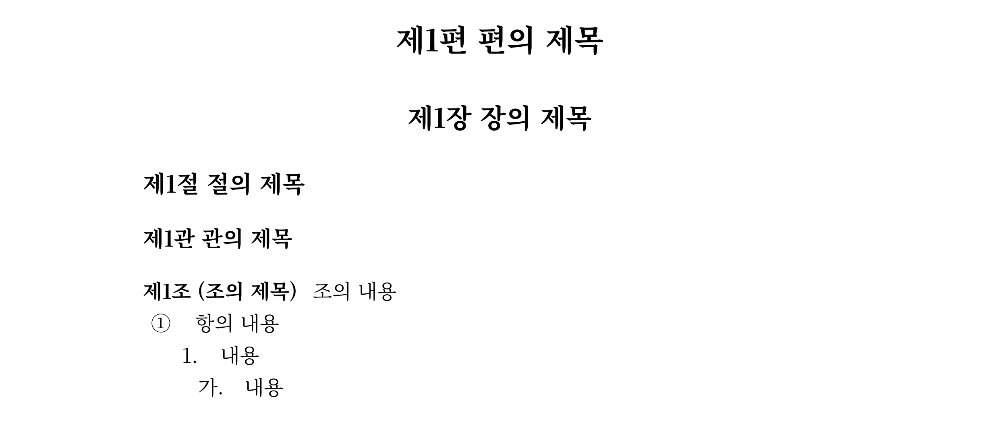
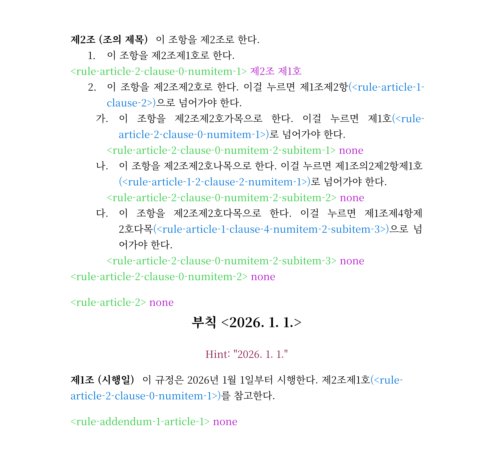
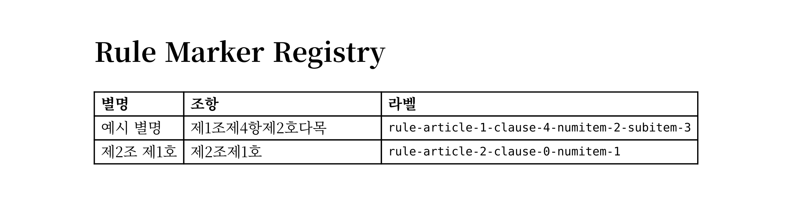

# 다듬: Typst 한국어 규정 문서 양식

이 양식은 여러 종류의 규정 문서를 Typst로 제작할 수 있도록 하기 위해 만들어졌습니다.

## 용도 예시

- **거의 모든 종류의 규정 문서**: 아래와 같이 법령과 같은 체계 혹은 법령 체계의 일부분으로 구성된 규정 문서라면 이 양식을 이용해 작성할 수 있습니다.
  - 본칙과 부칙이 있음
  - 편·장·절·관으로 구분됨
  - 조·항·호·목 체계를 따름
- **(특히 규정 문서와 관련된) 일반 문서**: Typst의 문법을 이용하여 일반 문서 역시 작성할 수 있습니다.
  - 개정안: 신·구조문대비표를 내장하고 있어 쉽게 작성할 수 있습니다.

## 사용법

이 양식은 Typst 패키지(`dadeum-rules`) 형태로 되어 있습니다. 컴퓨터에 Typst를 설치해 사용하는 경우에는 로컬 패키지로, [Typst 웹앱](https://typst.app/)에서 사용하는 경우에는 파일을 프로젝트에 직접 올려 사용합니다. 두 방법 모두 문서 맨 앞의 불러오기 경로만 다르고, 나머지 작성법은 같습니다.

### 로컬 패키지로 사용하기

#### 설치

1. 터미널에서 `typst info`를 실행해 Package path를 확인합니다. 보통 아래 경로입니다.
   - Linux: `~/.local/share/typst/packages`
   - macOS: `~/Library/Application Support/typst/packages`
   - Windows: `%APPDATA%\typst\packages`
2. 그 아래에 `local/dadeum-rules/0.1.0` 폴더를 만들고, 이 저장소의 파일을 복사합니다. 폴더 이름의 버전은 `typst.toml`의 `version`과 같아야 합니다.

   ```
   {Package path}/local/dadeum-rules/0.1.0/
   ├── typst.toml
   ├── lib.typ
   ├── template.typ
   ├── renders.typ
   ├── preset/
   └── template/
   ```

   Git을 사용한다면 아래처럼 바로 내려받을 수도 있습니다(Linux 기준).

   ```sh
   git clone https://github.com/fennecfoxsw/dadeum-rules ~/.local/share/typst/packages/local/dadeum-rules/0.1.0
   ```

#### 새 문서 만들기

아래 명령은 정관 예시가 들어 있는 새 프로젝트 폴더를 만듭니다.

```sh
typst init @local/dadeum-rules:0.1.0 my-rules
```

`my-rules/main.typ`를 열어 편집하면 됩니다.

### Typst 웹앱에서 사용하기

Typst 웹앱에서는 로컬 패키지를 사용할 수 없으므로 패키지 파일을 프로젝트에 직접 올려야 합니다.

1. Typst 웹앱에 로그인한 다음 상단 + Empty document 버튼을 눌러주세요.
2. Project name을 입력해주세요.
3. 파일 목록이 보이지 않는 경우, 왼쪽 맨 위 아이콘(Explore files)을 눌러주세요.
4. Files 메뉴에서 `dadeum-rules` 폴더를 만들고, 그 안에 이 저장소의 `lib.typ`, `template.typ`, `renders.typ` 파일과 `preset` 폴더(`basic.typ`, `full.typ`, `mod.typ`)를 같은 구조로 올려주세요.

   ```
   (프로젝트)
   ├── main.typ
   └── dadeum-rules/
       ├── lib.typ
       ├── template.typ
       ├── renders.typ
       └── preset/
           ├── basic.typ
           ├── full.typ
           └── mod.typ
   ```

5. 준비가 모두 끝났습니다. 문서는 기본적으로 생성된 `main.typ` 파일에서 편집하며, 맨 앞에 아래 두 줄을 작성합니다.

   ```typst
   #import "dadeum-rules/lib.typ": *
   #import preset.basic: *
   ```

### preset 고르기

두 번째 줄의 preset은 규정의 단계 구성을 정합니다.

| preset         | 계층        | 단계        |
| -------------- | ----------- | ----------- |
| `preset.basic` | 장·절       | 조·항·호·목 |
| `preset.full`  | 편·장·절·관 | 조·항·호·목 |

대부분의 단체 규정은 `preset.basic`으로 충분합니다. 편이나 관이 필요한 긴 규정이라면 `preset.full`을 사용하고, 목차에 관까지 표시하려면 `#toc-page(depth: 5)`를 사용합니다.

## 작성법

먼저, 문서의 시작 부분에서 양식을 불러오고 `rule-document`를 호출해야 합니다.

```typst
#import "@local/dadeum-rules:0.1.0": * // 웹앱에서는 "dadeum-rules/lib.typ"
#import preset.basic: *
#show: rule-document.with(document-title: "규정 명칭")
```

### 페이지 구성하기

#### 표지와 목차 페이지

표지와 목차 페이지를 배치하기 전, 아래 코드를 통해 페이지 레이아웃을 설정해야 합니다.

```typst
#show: cover-page
```

표지는 아래 2개 중 하나를 선택하여 사용할 수 있습니다.

```typst
#cover(
  [규정 문서 양식 \ 레퍼런스],
  "1970. 01. 01",
  rgb("#239dad"),
  image("sub_logo.png", height: 10mm),
  image("main_logo.png", height: 15mm),
)
```

위 코드는 로고와 제목, 개정 일자와 간단한 장식이 포함된 표지 페이지를 만듭니다. 함수의 4번째 인수로 오는 이미지는 표지 페이지의 왼쪽 위에 배치되고, 5번째 인수로 오는 이미지는 가운데 하단에 배치됩니다. 왼쪽 위에 넣는 이미지로는 슬로건 등이 있을 수 있고, 가운데 하단에 넣는 이미지로는 공식 로고 등이 적절합니다.

```typst
#simple-cover(
  [규정 문서 양식 \ 레퍼런스],
  top-text: [문법을 간단히 확인하기 위함임.],
  bottom-text: [이 표지는 상단과 하단에 텍스트 삽입이 가능함.]
)
```

반면, 위 코드는 장식이 거의 없고 제목과 상·하단 텍스트가 직사각형 박스로 둘러싸여 있는 형태의 표지 페이지를 만듭니다.

|  |  |
| :-----------------------------------------------------: | :-------------------------------------------------------------------: |
|                        일반 표지                        |                              간단한 표지                              |

목차 페이지를 만들고 싶다면 표지 페이지 바로 아래에 아래 코드를 삽입하면 됩니다.

```typst
#toc-page()
```

#### 본문 페이지

문서의 본문을 작성하기 전, 아래 코드를 통해 페이지의 레이아웃을 설정해야 합니다.

```typst
#show: body-page
```

### 개정 이력

`#revision-history((...))` 형식으로 작성하는데, `...` 부분에는 `("날짜", "내용")` 형식이 옵니다. 구체적으로, 아래와 같이 작성합니다.

```typst
#revision-history((
  ("2020. 01. 01.", "제정"),
  ("2021. 01. 01.", "1차 개정"),
  ("2022. 01. 01.", "2차 개정"),
  ("2023. 01. 01.", "3차 개정"),
  ("2024. 01. 01.", "4차 개정"),
  ("2025. 01. 01.", "5차 개정"),
  ("2026. 01. 01.", "6차 개정"),
))
```


기본적으로 개정 이력은 위 사진과 같이 오른쪽 정렬됩니다. 다른 방향으로 정렬하고 싶다면 아래 코드처럼 정렬 방향을 따로 명시해줄 수 있습니다.

```typst
#revision-history((
  ...
), alignment: left)
```

`alignment`에는 `left`(왼쪽 정렬), `center`(가운데 정렬), `right`(오른쪽 정렬) 등의 값을 넣어줄 수 있습니다.

### 규정 작성하기

규정의 계층은 아래 함수들을 사용하여 작성합니다. 편과 관은 `preset.full`에서만 사용할 수 있습니다.

| 계층 | 함수                                                                                                                                                  | 결과                                                                                                         |
| :--- | ----------------------------------------------------------------------------------------------------------------------------------------------------- | :----------------------------------------------------------------------------------------------------------- |
| 편   | `#part[제목]`<br />`#branch-part[제목]`<br />`#manual-part(2)[제목]`<br />`#manual-part("2-2")[제목]`                                                 | **제1편 제목**<br />**제1편의2 제목**<br />**제2편 제목**<br />**제2편의2 제목**                             |
| 장   | `#chapter[제목]`<br />`#branch-chapter[제목]`<br />`#manual-chapter(3)[제목]`<br />`#manual-chapter("3-2")[제목]`                                     | **제1장 총칙**<br />**제1장의2 제목**<br />**제3장 제목**<br />**제3장의2 제목**                             |
| 절   | `#section-title[제목]`<br />`#branch-section-title[제목]`<br />`#manual-section-title(2)[제목]`<br />`#manual-section-title("2-2")[제목]`             | **제1절 제목**<br />**제1절의2 제목**<br />**제2절 제목**<br />**제2절의2 제목**                             |
| 관   | `#subsection[제목]`<br />`#branch-subsection[제목]`<br />`#manual-subsection(2)[제목]`<br />`#manual-subsection("2-2")[제목]`                         | **제1관 제목**<br />**제1관의2 제목**<br />**제2관 제목**<br />**제2관의2 제목**                             |
| 부칙 | `#addendum[부칙]`<br />`#addendum(hint: "2026. 1. 1.")[부칙 \<2026. 1. 1.\>]`                                                                         | **부칙**<br />**부칙 <2026. 1. 1.>**                                                                         |
| 조   | `#article[제목][내용]`<br />`#b-article[제목][내용]`<br />`#manual-article(7)[제목][내용]`<br />`#manual-article("8-9")[제목][내용]`                  | **제1조 (제목)** 내용<br />**제1조의2 (제목)** 내용<br />**제7조 (제목)** 내용<br />**제8조의9 (제목)** 내용 |
| 항   | `#clause[내용]`<br />`#manual-clause(7)[내용]`<br />`#manual-clause("8~9")[내용]`                                                                     | ① 내용<br />⑦ 내용<br />⑧ \~ ⑨ 내용                                                                          |
| 호   | `#numitem[내용]`<br />`#branch-numitem[내용]`<br />`#manual-numitem(7)[내용]`<br />`#manual-numitem("3-2")[내용]`<br />`#manual-numitem("8~9")[내용]` | 1. 내용<br />1의2. 내용<br />7. 내용<br />3의2. 내용<br />8 ~ 9. 내용                                        |
| 목   | `#subitem[내용]`<br />`#manual-subitem(7)[내용]`<br />`#manual-subitem("8~9")[내용]`                                                                  | 가. 내용<br />사. 내용<br />아 ~ 자. 내용                                                                    |



`manual-`을 붙인 함수(`manual-chapter`, `manual-article`, `manual-clause` 등)를 사용하면 번호를 직접 지정할 수 있습니다. 규정문에서는 불필요한 기능이지만 일반 문서, 특히 신·구조문대비표에서 유용합니다. `#manual-clause(번호)[내용]`과 같이 사용하며, `번호` 부분에는 일반 숫자가 올 수도 있지만 항, 호, 목의 경우 `"1~3"` 형태의 범위가 올 수도 있습니다. 직접 지정한 번호는 자동 번호에 영향을 주지 않습니다. 예를 들어 제2조 다음에 `#manual-article(7)`을 쓰고 이어서 `#article`을 쓰면, 뒤의 조는 제3조가 됩니다.

편·장·절·관과 조, 호는 가지번호를 사용할 수 있습니다. 앞에 `branch-`를 붙인 함수(`branch-chapter`, `branch-article`, `branch-numitem` 등)를 사용하며, 조는 `b-article`로 줄여 쓸 수도 있습니다. 가지번호 다음의 번호는 이어서 매겨집니다. 예를 들어 제1조, 제1조의2 다음의 조는 제2조입니다. 번호를 직접 지정할 때에는 `manual-` 함수의 번호 부분에 `"1-3"`처럼 작성하면 제1조의3이 됩니다.

부칙은 장과 비슷하지만 번호를 붙이지 않으며, 부칙이 시작되면 조 번호를 제1조부터 다시 매깁니다. 부칙이 여러 개인 경우 `#addendum(hint: "2026. 1. 1.")[부칙 \<2026. 1. 1.\>]`처럼 힌트를 붙여 두면 인용할 때 어느 부칙인지 구별할 수 있습니다. 힌트는 결과물에 표시되지 않습니다. 자세한 내용은 [부칙 인용에 대해](#부칙-인용에-대해)를 참고하십시오.

조에 속하는 항과 호, 항에 속하는 호, 호에 속하는 목은 **반드시 중첩하여 작성해야 합니다.** 즉, 아래와 같이 작성해야 합니다.

```typst
#article[조의 제목][
  이 조항을 제1조로 한다.
  #clause[이 조항을 제1조제1항으로 한다.]
  #clause[이 조항을 제1조제2항으로 한다.]
  #clause[이 조항을 제1조제3항으로 한다.]
]
```

단, 가지번호 조(제1조의2 등)는 별개의 조이므로 앞 조 안에 중첩하지 않고 따로 작성합니다.

### 규정 인용하기

> 인용이 의도한 조항으로 연결되는지 확인하려면 [디버그 모드](#디버그-모드)를 사용하십시오.

#### 직접 인용하기

'○○에 관하여는 제○조를 준용한다.'와 같은 준용문이나 '제○조에도 불구하고'와 같은 인용문같이, 같은 규정 내의 다른 조항을 인용해야 할 때가 있습니다. 이 경우 `at` 함수를 사용할 수 있습니다. 인용문을 글자로만 작성하는 것과 달리, `at` 함수를 사용하게 되면 해당 인용문을 클릭했을 때 인용된 조항으로 이동하는 링크가 추가됩니다.

`at` 함수는 조문 내부에서 `#at[인용 조항]`과 같이 사용하는데, `인용 조항` 부분에는 일반적으로 인용문을 작성하는 것처럼, `제○조제○항`, `제○조제○호`, `제○조제○항부터 제○항까지` 등의 형식으로 작성하면 됩니다. `인용 조항`에 작성한 내용 그대로 문서에 표시되며, `인용 조항`이 가리키는 조항을 향하는 링크가 삽입됩니다. 인용한 조항이 문서에 없으면 오류가 발생합니다.

인용문에서 일부 단계를 생략하면 아래 규칙에 따라 채웁니다.

- 처음 적은 단계보다 **상위 단계**를 생략하면 현재 위치의 것으로 채웁니다. 예를 들어 제3조 안에서 `#at[제2항]`은 제3조제2항을 가리킵니다.
- 적은 단계 **사이의 단계**를 생략하면 그 단계가 없는 것으로 봅니다. 예를 들어 `#at[제1조제1호]`는 항이 없는 제1조의 제1호를 가리킵니다.

예를 들어, 현재 제3조 제4항 제5호 바목을 작성하고 있다고 가정합니다.

| `at` 함수의 쓰임                                         | 링크 위치              | 표시되는 내용                                       |
| -------------------------------------------------------- | ---------------------- | --------------------------------------------------- |
| `... #at[다목] ...`                                      | 제3조 제4항 제5호 다목 | `... 다목 ...`                                      |
| `... #at[제3호] ...`                                     | 제3조 제4항 제3호      | `... 제3호 ...`                                     |
| `... #at[제2항] ...`                                     | 제3조 제2항            | `... 제2항 ...`                                     |
| `... #at[제1조] ...`                                     | 제1조                  | `... 제1조 ...`                                     |
| `... #at[제3항제4호] ...`                                | 제3조 제3항 제4호      | `... 제3항제4호 ...`                                |
| `... #at[제1조제1호] ...`                                | 제1조 제1호            | `... 제1조제1호 ...`                                |
| `... #at[제2조제3항부터 제6항까지] ...`                  | 제2조 제3항            | `... 제2조제3항부터 제6항까지 ...`                  |
| `#at[제2호, 제3호 및 제4호]의 어느 하나에 해당하는 경우` | 제3조 제4항 제2호      | `제2호, 제3호 및 제4호의 어느 하나에 해당하는 경우` |

마지막 두 예시처럼 하나의 `at` 함수에 같은 단계의 조항이 여러 개 오면, 그중 첫 번째 조항을 가리키는 링크가 삽입되며 나머지 조항은 존재 여부를 검증하지 않습니다. 각 조항에 링크를 걸고 존재 여부도 검증하려면 `#at[제2호], #at[제3호] 및 #at[제4호]의 어느 하나에 해당하는 경우`처럼 조항마다 `at` 함수를 사용하십시오.

서로 다른 단계의 조항을 하나의 `at` 함수에 함께 쓰면 안 됩니다. 예를 들어 `#at[제1항 및 제1조제1호]`는 두 조항을 따로 인식하지 않고 단계별 번호를 합쳐 제1조제1항제1호를 찾으므로, 의도와 다른 곳에 연결되거나 오류가 발생합니다. 이 경우 `#at[제1항] 및 #at[제1조제1호]`처럼 나누어 작성하십시오.

#### 별명으로 인용하기

조항에 별명을 짓고, 그 별명으로 조항을 인용할 수 있습니다. 조·항·호·목을 새로 넣어 기존 조항의 번호가 바뀌더라도, 별명으로 인용한 곳의 인용문과 링크는 바뀐 번호에 맞게 자동으로 바뀐다는 장점이 있습니다.

조항에 별명을 지으려면 `[제목][내용]` 혹은 `[내용]` 앞에 `(m: "별명")`을 붙입니다. 앞에 `manual-`이 붙은 함수는 이미 `(번호)`가 있으므로, 그 괄호 안에 `m: "별명"`을 덧붙여 `(번호, m: "별명")`으로 바꿉니다. 별명의 형식은 제한하지 않지만, 해당 조항을 요약하는 짧은 한두 단어를 추천합니다. 별명은 조·항·호·목에만 지을 수 있으며, 편·장·절·관과 부칙 제목은 인용 대상이 아니므로 별명을 지을 수 없습니다.

| 계층 | 별명을 지으려는 함수                                                                                                                 | 별명을 지은 함수                                                                                                                                                                 |
| :--- | :----------------------------------------------------------------------------------------------------------------------------------- | :------------------------------------------------------------------------------------------------------------------------------------------------------------------------------- |
| 조   | `#article[제목][내용]`<br />`#b-article[제목][내용]`<br />`#manual-article(7)[제목][내용]`<br />`#manual-article("8-9")[제목][내용]` | `#article(m: "별명")[제목][내용]`<br />`#b-article(m: "별명")[제목][내용]`<br />`#manual-article(7, m: "별명")[제목][내용]`<br />`#manual-article("8-9", m: "별명")[제목][내용]` |
| 항   | `#clause[내용]`<br />`#manual-clause(7)[내용]`<br />`#manual-clause("8~9")[내용]`                                                    | `#clause(m: "별명")[내용]`<br />`#manual-clause(7, m: "별명")[내용]`<br />`#manual-clause("8~9", m: "별명")[내용]`                                                               |
| 호   | `#numitem[내용]`<br />`#branch-numitem[내용]`<br />`#manual-numitem(7)[내용]`<br />`#manual-numitem("8~9")[내용]`                    | `#numitem(m: "별명")[내용]`<br />`#branch-numitem(m: "별명")[내용]`<br />`#manual-numitem(7, m: "별명")[내용]`<br />`#manual-numitem("8~9", m: "별명")[내용]`                    |
| 목   | `#subitem[내용]`<br />`#manual-subitem(7)[내용]`<br />`#manual-subitem("8~9")[내용]`                                                 | `#subitem(m: "별명")[내용]`<br />`#manual-subitem(7, m: "별명")[내용]`<br />`#manual-subitem("8~9", m: "별명")[내용]`                                                            |

같은 별명은 한 문서에서 한 번만 쓸 수 있습니다. 같은 별명이 두 곳 이상에 붙어 있으면, 그 별명을 인용하지 않았더라도 오류가 발생하며 오류 메시지에 별명이 붙은 조항들이 모두 표시됩니다.

별명으로 조항을 인용할 때에는 `at` 대신 `at-m`을 사용합니다. `at-m`은 '제○조제○항제○호○목' 형식의 인용문을 만들되, 현재 위치와 겹치는 상위 단계는 생략하여 가장 짧은 인용문을 만듭니다. 예를 들어 제3조 제4항 제5호에서 별명이 `삼이`인 제3조 제2항을 `#at-m("삼이")`로 인용하면 '제2항'이 작성됩니다. 부칙의 조항을 본칙에서 인용하면 '부칙 제1조제2항'처럼 앞에 '부칙'이 붙습니다.

여러 조항을 한 번에 인용할 수도 있습니다. 이때 각 조항은 바로 앞 조항과 겹치는 상위 단계를 생략합니다.

| 쓰임                                 | 결과 예시                  |
| ------------------------------------ | -------------------------- |
| `#at-m("별명")`                      | 제2항                      |
| `#at-m(("별명1", "별명2", "별명3"))` | 제2항, 제3항 및 제5조제1항 |
| `#at-m((("시작별명", "끝별명"),))`   | 제2항부터 제4항까지        |

나열 인용은 괄호 안에 별명들을 넣고, 범위 인용은 괄호를 한 겹 더 감싸 시작과 끝 별명 두 개를 넣습니다.

또한, 드문 경우이지만 `#manual-clause("8~9", m: "팔부터구")[내용]`처럼 범위로 지정된 조항을 `#at-m("팔부터구")`로 인용하면 '제8항부터 제9항까지'와 같은 범위 인용문이 작성됩니다. 반면, 이런 조항을 `#at[제8항부터 제9항까지]`처럼 `at` 함수로 인용하면 인용 대상을 찾을 수 없다는 오류가 발생합니다. 따라서 `manual-` 함수로 작성한 범위 조항은 별명으로만 인용할 수 있습니다.

#### 부칙 인용에 대해

부칙에서 본칙을 인용해야 하거나, 본칙에서 부칙을 인용해야 하는 경우, `at` 함수에 '부칙' 글자를 넣어 인용 대상의 위치가 부칙임을 알릴 수 있습니다. 이 경우 아래와 같이 작동합니다.

| 함수가 사용되는 위치 | 인용문에 '부칙'이 있는지 | 인용 대상의 조⋅항⋅호⋅목                  | 인용 대상을 실제로 찾는 곳 |
| -------------------- | ------------------------ | ---------------------------------------- | -------------------------- |
| 본칙                 | 없음                     | 상관 없음                                | 본칙                       |
| 본칙                 | 있음                     | 상관 없음                                | 부칙                       |
| 부칙                 | 있음                     | 상관 없음                                | 부칙(자기 부칙)            |
| 부칙                 | 없음                     | **조 포함**                              | **본칙**                   |
| 부칙                 | 없음                     | **조 미포함, 항⋅호⋅목 중 1개 이상 포함** | **부칙(자기 부칙)**        |

이는 부칙 내에서 조를 인용하는 경우 대부분 본칙이고, 항⋅호⋅목에서만 인용하는 경우 대부분 부칙이라는 경험 법칙에 의거합니다. 그러나 법령 입안 심사 기준에는 부칙에서 부칙 내 다른 조항을 인용할 때에는 '부칙 제○조' 등과 같이 부칙임을 표시하여 본칙 규정을 인용할 때와 구별하라고 적혀 있으므로 이 원칙을 따를 것을 권장합니다.

##### 부칙이 여러 개인 경우

개정할 때마다 부칙이 추가되면 한 문서에 부칙이 여러 개 생깁니다. 이때 어느 부칙을 인용하는지 구별하기 위해 부칙에 힌트를 붙일 수 있습니다.

```typst
#addendum(hint: "2025. 1. 1.")[부칙 \<2025. 1. 1.\>]
#addendum(hint: ("제3호", "2026. 1. 1."))[부칙 \<제3호, 2026. 1. 1.\>]
```

힌트는 그 부칙을 가리키는 문자열로, 공포번호, 개정일, 개정 차수 등 무엇이든 될 수 있으며 여러 개라면 배열로 넘깁니다. 힌트는 결과물에 표시되지 않으므로, 결과물에 보여야 하는 내용은 제목에 직접 작성합니다.

'부칙'이 들어간 인용문은 아래 순서로 인용할 부칙을 정합니다.

1. 인용문에 어느 부칙의 힌트가 들어 있으면 그 부칙을 가리킵니다. 예를 들어 `#at[부칙 \<2025. 1. 1.\> 제1조]`는 힌트가 `"2025. 1. 1."`인 부칙의 제1조를 가리킵니다.
2. 힌트가 없고 부칙 안에서 인용하면, 그 부칙 자신을 가리킵니다.
3. 힌트가 없고 본칙에서 인용하면, 부칙이 하나뿐인 경우에만 그 부칙을 가리킵니다. 부칙이 여러 개라면 어느 부칙인지 알 수 없으므로 오류가 발생하며, 오류 메시지에 각 부칙의 힌트 목록이 표시됩니다.

인용문이 서로 다른 부칙의 힌트와 동시에 일치하는 경우에도 오류가 발생합니다. 단, 더 긴 힌트 안에 포함된 짧은 힌트(예: `"11차"` 안의 `"1차"`)는 일치로 보지 않습니다.

별명으로 인용하는 `at-m`은 별명이 붙은 조항의 위치를 직접 알고 있으므로 힌트가 필요 없습니다. 부칙의 조항을 본칙이나 다른 부칙에서 인용하면 '부칙 제1조제2항'처럼 앞에 '부칙'이 자동으로 붙습니다.

### 신·구조문대비표

`side-by-side-table((...))`함수에 `compare-row([...], [...], remark: [...])`함수를 쌓아 만들 수 있습니다. 대략 아래와 같은 형식입니다.

```typst
#side-by-side-table((
  compare-row([...], [...], remark: [...]),
  compare-row([...], [...], remark: [...]),
  compare-row([...], [...], remark: [...]),
  ...
))
```


구체적으로, `side-by-side-table` 함수는 인자로 배열(리스트)을 받습니다. 그 배열에는 `compare-row([...], [...], remark: [...])`이 들어가야 합니다.

`compare-row` 함수는 첫 번째 인수에 현행 내용, 두 번째 인수에 개정 내용, `remark: `와 함께 오는 인수에 비고란에 오는 내용을 넣어 사용합니다. 첫 번째와 두 번째 인수에는 `manual-`로 시작하는 함수들, 즉 `manual-article`, `manual-clause`, `manual-numitem`, `manual-subitem`을 사용하여 작성해야 하며, 필요한 경우 항, 호, 목에 범위 표현을 사용할 수 있습니다. 또한 표 안의 조항은 인용 대상이 아니므로 `at`이나 `at-m`으로 인용할 수 없습니다.

또한, `side-by-side-table` 함수의 인수로 `hide-inner-stroke`, `no-inset`, `hide-remark`를 같이 넘길 수 있습니다.

- `hide-inner-stroke`: `true`면 표 내부의 가로선을 그리지 않습니다. (기본값: `false`)
- `no-inset`: `true`면 표의 각 셀 안쪽 내용을 둘러싸는 여백을 두지 않습니다. (기본값: `false`)
- `hide-remark`: `true`면 비고 열이 안 보입니다. (기본값: `false`)

만약 조항 단위로 세로 위치를 맞추고 싶은 경우, 조⋅항⋅호⋅목 단계와 상관없이, 조항 당 하나의 `compare-row`를 사용할 수 있습니다. 이 경우, `hide-inner-stroke: true`, `no-inset: true`를 추천합니다(`#side-by-side-table(hide-inner-stroke: true, no-inset: true, (...))`).


### 일반 문서

Typst의 문법을 그대로 사용할 수 있습니다. Typst로 문서를 작성하는 방법에 대해서는 [공식 문서의 튜토리얼](https://typst.app/docs/tutorial/writing-in-typst/)을 참고하십시오.

제목은 2단계부터 6단계까지 1., 가., 1), 가), (1) 형식으로 번호를 매깁니다. 1단계 제목은 번호 매김 없이 왼쪽 정렬된, 굵고 큰 텍스트를 만듭니다.

### 문장 부호

자주 사용하지만, 키보드로 입력하기 힘든 몇 가지 문장 부호를 함수로 사용할 수 있습니다.

| 문장부호 함수                           | 결과                       |
| --------------------------------------- | -------------------------- |
| `#d-bracket[겹낫표]`                    | 『겹낫표』                 |
| `#d-arrow[겹화살괄호]`                  | 《겹화살괄호》             |
| `#s-bracket[홑낫표]`                    | ｢홑낫표｣                   |
| `#s-arrow[홑화살괄호]`                  | 〈홑화살괄호〉             |
| `이것 #cdot 저것`<br />`이것#cdot\저것` | 이것 · 저것<br />이것·저것 |

홑화살괄호의 경우, 키보드에서 입력할 수 있는 `<`, `>`와는 다른 기호를 사용합니다.

## 고급 사용법

### 문서 여백 변경하기

`rule-document` 함수는 3개의 여백 관련 인자를 받습니다.

```typst
#show: rule-document.with(
  ...,
  margin: (top: 30mm, bottom: 30mm, left: 30mm, right: 30mm, footer: 15mm),
  compact-margin: (top: 15mm, bottom: 15mm, left: 20mm, right: 20mm, footer: 3mm),
  cover-margin: (top: 30mm, bottom: 30mm, left: 30mm, right: 30mm, footer: 15mm),
)
```

`margin`과 `compact-margin`은 본문에서, `cover-margin`은 표지 페이지에서 사용되는 여백입니다. `cover-margin`을 지정하지 않으면 `margin`과 같은 값을 사용합니다. 각 여백 인자는 위의 코드처럼, `(top: ..., bottom: ..., left: ..., right: ..., footer: ...)` 형식의 값을 받으며(키 순서는 상관없고, `footer`를 생략하면 `top`의 절반이 사용됩니다), 각각 위쪽 여백, 아래쪽 여백, 왼쪽 여백, 오른쪽 여백, 꼬리말(페이지 번호) 위치입니다. 단, 일반적인 문서 편집 프로그램과 다르게, 꼬리말 위치는 문서의 가장 아래(즉, 종이 아래쪽 모서리에서 `bottom`만큼 위)에서 내려갈 길이가 됩니다. 예를 들어, `bottom`이 15mm이고, `footer`가 3mm라면 하단 여백은 15mm가 되고, 꼬리말은 15mm에서 3mm만큼 더 내려간, 종이 아래쪽 모서리에서 12mm에 놓이게 됩니다.

본문 페이지에서 여백을 넓게 할 것인지, 좁게 할 것인지 여부는 `body-page` 함수가 결정합니다. 아래 코드처럼 작성하면 `margin`에 지정된 넓은 여백을 사용합니다.

```typst
#show: body-page
```

`compact-margin`에 지정된 좁은 여백을 사용하려면 아래와 같이 작성합니다.

```typst
#show: body-page.with(compact-margin: true)
```

넓은 여백은 규정 문서를 작성할 때, 좁은 여백은 개정안과 같은 일반 문서를 작성할 때 처럼 용도를 정해 사용할 수 있습니다.

### 글꼴 변경하기

`rule-document` 함수는 3개의 글꼴 관련 인자를 받습니다.

```typst
#show: rule-document.with(
  ...,
  serif: "Noto Serif CJK KR",
  san-serif: "Noto Sans CJK KR",
  default-font-type: "serif",
)
```

`serif`에는 바탕 글꼴을, `san-serif`에는 고딕 글꼴을 지정할 수 있으며, `default-font-type`에 `"san-serif"` 혹은 `"고딕"`을 넣는다면 문서 전체에 사용할 글꼴을 지정할 수 있습니다.

기본적으로 위의 예시 코드에도 적혀있는 본명조와 본고딕이 사용됩니다. 만약 웹(`typst.app`)에서 문서를 편집하고 있고, 다른 글꼴을 사용하고 싶다면 해당 글꼴 파일을 프로젝트에 업로드한 다음 글꼴의 영어 이름을 작성하면 됩니다. 예를 들어, 마루 부리를 사용하고 싶은 경우 `serif: "MaruBuri"`를 넘겨주면 됩니다. 아래는 몇 가지 자주 사용되는 글꼴(바탕)에 대한 영어 이름입니다.

- 본명조: `Noto Serif CJK KR`
- 나눔명조: `NanumMyeongjo`
- 마루부리: `MaruBuri`
- KoPub World/KoPub 2.0: `KoPubWorldBatang`/`KoPubBatang`
- 고운바탕: `Gowun Batang`
- 함초롱바탕: 용량이 너무 커 사용 불가

### 글자 크기 변경하기

`font-size`로 본문의 기본 글자 크기를 바꿀 수 있습니다. 기본값은 `12pt`입니다.

```typst
#show: rule-document.with(
  ...,
  font-size: 11pt,
)
```

본문 글자뿐 아니라 장·절 제목, 조항의 들여쓰기와 간격, 목차, 개정 이력, 신·구조문대비표의 글자 크기도 이 값에 비례하여 함께 바뀝니다. 신·구조문대비표의 글자는 본문의 5/6 크기입니다. 표지와 페이지 번호는 글자 크기와 상관없이 같은 크기로 유지됩니다.

### 페이지 번호 형식 변경하기

`rule-document` 에 아래와 같이 작성하면 페이지 번호 형식을 변경할 수 있습니다.

```typst
#show: rule-document.with(
  ...,
  page-numbering: (content: [-- 1 --], alignment: center),
)
```

`page-numbering`를 통해 페이지 번호 형식을 지정해줄 수 있는데, 위의 예시 코드처럼 `(content: ..., alignment: ..., size: ...)`형식 혹은 `[...]`나 `"..."`와 같은 값을 넘겨도 됩니다. 이때, `[...]`, `"..."`에는 숫자가 포함되어 있어야 합니다. 예를 들어, `"1 페이지"`처럼 작성하면 꼬리말에 '3 페이지', '4 페이지', ...처럼 작성됩니다. 만약 `[*1* 페이지]`와 같이 서식을 넣는다면 해당 서식이 그대로 반영됩니다. 예시의 경우, '**1** 페이지'처럼 숫자가 굵게 작성됩니다. `content: ...`의 `...` 부분에도 앞선 설명과 똑같은 `[...]`나 `"..."` 형식을 넣을 수 있습니다. 추가로, `alignment`에는 페이지 번호를 어디에 정렬할지 선택할 수 있으며, `left`(왼쪽 정렬), `center`(가운데 정렬), `right`(오른쪽 정렬) 등의 값을 넣어줄 수 있습니다. `size`에는 페이지 번호의 글자 크기를 넣을 수 있으며, 지정하지 않으면 `12pt`입니다.

`[...]`나 `"..."` 형식에서는 들어 있는 숫자가 **모두** 현재 쪽 번호로 바뀝니다. 따라서 `"1 / 10"`이나 `"2026년 1쪽"`처럼 숫자가 둘 이상 필요한 형식은 아래와 같이 함수 형식으로 작성합니다.

```typst
#show: rule-document.with(
  ...,
  page-numbering: p => [#p.page / #p.total],
)
```

함수는 쪽 정보를 담은 값 `p` 하나를 받으며, `p.page`는 현재 쪽 번호, `p.total`은 문서 전체 쪽수입니다. 딕셔너리 형식의 `content`에도 함수를 넣을 수 있습니다(예: `(content: p => [#p.page 쪽], alignment: right)`).

쪽 번호는 표지와 목차를 포함한 실제 쪽 위치를 따릅니다. 표지와 목차 페이지에는 번호가 표시되지 않지만 쪽 수는 세어지므로, 본문 첫 쪽의 번호는 1이 아닐 수 있습니다. 목차의 쪽 번호도 같은 기준입니다.

### 링크 색 바꾸기

기본적으로 특정 조항을 인용하여 링크를 삽입해도 해당 인용문의 글자 색은 변하지 않습니다. 인용문을 포함하여 모든 링크의 글자 색을 바꾸고 싶다면 아래와 같이 작성하면 됩니다.

```typst
#show: rule-document.with(
  ...,
  link-color: blue,
)
```

사용할 수 있는 색에 대해서는 [Typst 문서](https://typst.app/docs/reference/visualize/color/)를 참고하십시오. 위 예시에서 `blue`는 `rgb("#0074d9")`와 같으며, 링크 글자 색을 `#0074d9` 색으로 바꿉니다.

### 디버그 모드

`rule-document` 함수는 문서 전체에 걸쳐 디버그 모드를 켜거나 끌 수 있습니다. 이는 인용과 관련하여 링크가 잘못 연결되거나 인용 관련 오류가 발생하는 경우 그 원인을 찾는데 유용합니다. `rule-document` 호출을 아래처럼 수정하여 디버그 모드를 사용할 수 있습니다.

```typst
#show: rule-document.with(
  ...,
  debug: true,
)
```

디버그 모드가 켜지면 각 조항이 끝나는 부분 아래에 초록색 글씨(조항의 라벨)와 보라색 글씨(조항의 별명, 없으면 `none`)가 나타나고, `at`과 `at-m`이 사용된 부분에 파란색 글씨(인용 대상의 라벨)가 나타납니다. `at`이 사용된 경우 초록색 글씨의 내용이 인용된 부분의 파란색 글씨의 내용과 일치해야 합니다. `at-m`이 사용된 경우 `at-m`에 사용한 별명과 보라색 글씨가 일치한 곳을 찾은 다음 그쪽에 표시된 초록색 글씨의 내용과 `at-m`에 표시된 파란색 글씨의 내용이 일치해야 합니다. 만약 일치하지 않다면 이는 양식의 버그로, 이슈를 남겨주시기 바랍니다. 또한 부칙 제목 아래에는 그 부칙의 힌트가 표시됩니다.

디버그 모드에서는 컴파일을 멈추는 대신 문제가 있는 곳에 빨간 글씨를 표시합니다. 그래서 오류가 여러 개여도 한 번에 확인할 수 있습니다.

| 빨간 글씨                     | 위치        | 원인                                                     |
| ----------------------------- | ----------- | -------------------------------------------------------- |
| `해당 위치를 찾을 수 없음.`   | `at` 뒤     | 인용한 조항이 문서에 없음                                |
| `(오류 내용)`                 | `at` 뒤     | 인용문을 해석할 수 없거나, 어느 부칙인지 정할 수 없음    |
| `"별명" 별명을 찾을 수 없음.` | `at-m` 자리 | 그런 별명이 붙은 조항이 없음                             |
| `"별명" 별명이 중복됨`        | `at-m` 자리 | 같은 별명이 여러 조항에 붙어 있음                        |
| `별명이 중복됨`               | 조항 아래   | 이 조항의 별명이 다른 조항에도 붙어 있음                 |
| `사용할 수 없는 목 번호`      | 조항 아래   | 번호가 그 단계에서 쓸 수 있는 범위를 넘음(예: 57번째 목) |



또한, 맨 마지막 장에 제목이 `Rule Marker Registry`인 새로운 페이지가 만들어집니다. 이 페이지에는 문서에서 사용한 별명이 **별명 / 조항 / 라벨** 세 열의 표로 정리됩니다. 조항 열은 그 별명이 붙은 조항의 전체 인용문(예: '부칙 제1조제2항')이고, 라벨 열은 그 조항의 라벨입니다. 같은 별명이 여러 조항에 붙어 있으면 별명 옆에 빨간색으로 '(중복)'이 표시됩니다. 조항 열의 인용문이 실제로 그 별명을 붙인 조항과 다르다면 이 역시 양식의 버그로, 이슈를 남겨주시기 바랍니다.



### 문서 설정 기본값

아래 코드는 `#show: rule-document`를 했을 때 기본으로 설정되는 값들을 모아 `#show: rule-document(...)` 형식으로 만든 것입니다.

```typst
#show: rule-document.with(
  document-title: none,
  serif: "Noto Serif CJK KR",
  san-serif: "Noto Sans CJK KR",
  default-font-type: "serif",
  font-size: 12pt,
  margin: (top: 30mm, bottom: 30mm, left: 30mm, right: 30mm, footer: 15mm),
  compact-margin: (top: 15mm, bottom: 15mm, left: 20mm, right: 20mm, footer: 3mm),
  cover-margin: none, // 지정하지 않으면 margin과 같음
  page-numbering: (content: [-- 1 --], alignment: center), // size를 지정하지 않으면 12pt
  link-color: none,
  debug: false,
)
```

여기서 상당 부분을 수정하고 싶은 경우, 위 코드를 복사한 다음 수정하는 것을 추천합니다.

## 단계 구성 바꾸기

장·절이나 조·항·호·목 같은 단계는 preset이 정의합니다. 기본으로 들어 있는 `preset.basic`, `preset.full`로 충분하지 않다면 아래 세 가지 방법을 통해 직접 수정할 수 있습니다.

### 생김새 일부만 바꾸기

각 단계를 만들 때 쓴 정의 인자가 함께 공개되어 있습니다(`chapter-args`, `clause-args` 등). 이를 이용해 문서에서 같은 이름으로 다시 정의하면, preset을 고치지 않고 필요한 값만 바꿀 수 있습니다.

```typst
#import "@local/dadeum-rules:0.1.0": *
#import preset.basic: *

// 장 제목을 크게, 항의 번호와 본문 사이를 넓게
#let (chapter, branch-chapter, manual-chapter, chapter-args) = make-division(
  ..chapter-args,
  style: (..chapter-args.style, size: 1.5em),
)
#let (clause, manual-clause, clause-args) = make-level(
  ..clause-args,
  style: (..clause-args.style, num-width: 2.6em),
)

#show: rule-document.with(...)
```

- 다시 정의는 **import 바로 아래**, 해당 단계를 처음 쓰기 전에 하십시오. 앞에서 이미 쓴 단계를 뒤에서 다시 정의하면 한 단계에 두 가지 정의가 섞여 오류가 발생합니다.
- 받는 이름의 개수는 가지번호 여부에 따라 다릅니다. 가지번호가 있는 단계(편·장·절·관, 조, 호)는 (자동 함수, 가지번호 함수, 수동 함수, 정의 인자) 4개, 없는 단계(항, 목)는 (자동 함수, 수동 함수, 정의 인자) 3개입니다. 개수가 틀리면 오류가 발생합니다.

### style에 쓸 수 있는 값

각 단계는 자기 단계를 그리는 `render` 함수와 이 함수에서 주로 생김새를 조정하는데 사용할 수 있는 `style` 딕셔너리를 정의합니다. 아래는 기본 preset의 `render`가 사용하는 의미입니다.

길이는 단위에 따라 동작이 다르며, 값마다 골라 쓰거나 `1.5em + 2mm`처럼 섞어 쓸 수 있습니다.

- **pt, mm 등 절대 단위**: 고정 크기입니다. `font-size`를 바꿔도 그대로입니다.
- **em**: 글자 크기에 비례합니다. 조항 단계는 그 단계의 `size`(지정하지 않았으면 그 위치의 글자 크기), 계층과 부칙은 본문 글자 크기가 기준입니다.

조항 단계(`make-level`):

| 키                                        | 형식                            | 뜻                                                                                   |
| ----------------------------------------- | ------------------------------- | ------------------------------------------------------------------------------------ |
| `num-indent`                              | 길이 또는 부모별 딕셔너리       | 번호가 시작하는 위치(부모 본문의 왼쪽 끝 기준, 음수 가능)                            |
| `num-width`                               | 길이                            | 번호 시작부터 본문 시작까지의 폭                                                     |
| `min-gap`                                 | 길이                            | 번호가 길 때 번호와 본문 사이에 남길 최소 간격('1.'의 마침표까지 포함한 번호 끝부터) |
| `above`, `below`                          | 길이                            | 위아래 간격                                                                          |
| `size`                                    | 길이                            | 그 단계의 번호와 본문 글자 크기                                                      |
| `title-size`, `title-weight`, `title-gap` | 길이, 문자열 또는 정수, 길이    | 조 제목의 크기, 굵기, 제목 뒤 간격(제목이 있는 단계만)                               |
| `table-indent`, `table-gap`               | 길이 또는 부모별 딕셔너리, 길이 | 신·구조문대비표 안의 들여쓰기와 번호 뒤 간격                                         |

계층(`make-division`)과 부칙(`make-addendum`): `size`, `weight`, `align`, `above`, `below`.

번호와 본문은 다음 규칙으로 놓입니다.

- 번호는 부모 본문의 왼쪽 끝에서 `num-indent`만큼 떨어진 곳에서 시작합니다. 음수이면 부모 본문보다 왼쪽으로 나옵니다.
- 본문은 번호가 시작하는 곳에서 `num-width`만큼 떨어진 곳에서 시작합니다. 그래서 같은 단계의 조항은 번호도 본문도 같은 위치에 맞춰집니다.
- 다만 번호가 길어 번호 끝과 본문 사이가 `min-gap`보다 좁아지면, 그 조항만 본문을 `min-gap`이 확보될 때까지 오른쪽으로 밀어냅니다. 두 자리 번호나 `8 ~ 9.` 같은 범위 번호가 이런 경우입니다. 번호 끝은 `1.`의 마침표까지 포함합니다.

즉, 본문의 시작 위치는 `num-indent` + max(`num-width`, 번호 폭 + `min-gap`)입니다.

부모별 딕셔너리는 `(default: 1.75em, clause: -0.65em)`처럼 부모 단계의 key로 값을 고르고, 없으면 `default`를 사용합니다(`default`는 필수입니다). 예를 들어 호는 항 안에 있을 때와 조 바로 아래 있을 때 번호 위치가 다릅니다.

`size`에 `0.9em`처럼 상대값을 쓰면 부모 단계의 크기를 기준으로 계산됩니다. 하위 단계는 상위 단계 안에 들어 있으므로, 호를 줄이면 그 안의 목도 함께 줄어듭니다.

### 단계 추가하기

`make-level`로 새 단계를 만들어 바로 쓸 수 있으며, 인용(`at`, `at-m`)에도 자동으로 반영됩니다. 아래는 목 아래에 세목(1), 2), …)을 추가하는 예입니다.

```typst
#import "@local/dadeum-rules:0.1.0": *
#import preset.basic: *

#let (detail, manual-detail, detail-args) = make-level(
  key: "detail",           // 라벨에 쓰이는 이름(영문 소문자·숫자)
  depth: 4,                // 조=0, 항=1, 호=2, 목=3
  bare: n => str(n),       // 번호 본체
  suffix: ")",             // 번호 뒤 기호 → "1)", 범위 "1 ~ 2)"
  unit: ")",               // 인용문: cite-prefix + 번호 + unit → "1)"
  parse: regex("(\d+)\)"), // at()이 인용문에서 이 단계 번호를 찾는 규칙
  style: (..subitem-args.style, num-indent: -0.8em, num-width: 1.8em),
  render: renders.numbered,
)
```

`make-level`의 인자:

| 인자                               | 뜻                                                                                                                                                                                      |
| ---------------------------------- | --------------------------------------------------------------------------------------------------------------------------------------------------------------------------------------- |
| `key`                              | 단계 이름. 라벨(`rule-article-3-clause-1`)에 쓰입니다.                                                                                                                                  |
| `depth`                            | 단계 순서. 상위 단계가 바뀌면 하위 단계 번호가 1부터 다시 시작합니다.                                                                                                                   |
| `branch`                           | 가지번호 허용 여부. `true`면 가지번호 함수를 함께 돌려줍니다.                                                                                                                           |
| `title`                            | 제목을 받는 단계인지(조). `true`면 함수가 `[제목][내용]`을 받습니다.                                                                                                                    |
| `heading-level`                    | 제목을 heading으로 그릴 때의 제목 단계(목차 깊이와 연결). `preset.basic`의 조는 4, `preset.full`의 조는 6입니다.                                                                        |
| `bare`, `suffix`                   | 표시 번호: `bare(번호) + suffix`. `bare`가 `none`을 돌려주면 그 단계에서 쓸 수 없는 번호로 보고 오류를 냅니다. 목은 `hangeul-number`를 사용합니다.                                      |
| `cite-bare`, `cite-prefix`, `unit` | 인용문: `cite-prefix + cite-bare(번호) + unit`. `cite-bare`를 생략하면 `bare`를 사용합니다(항은 표시가 ①, 인용이 제1항이라 따로 지정).                                                  |
| `parse`                            | `at`이 인용문에서 이 단계를 찾는 정규식. (번호, 가지번호)를 캡처합니다. 캡처한 번호가 숫자가 아니면(예: 목의 "다") `cite-bare`(없으면 `bare`)로 1부터 만들어 보며 같은 번호를 찾습니다. |
| `style`                            | 위 표의 값                                                                                                                                                                              |
| `render`                           | 본문 안 생김새: `(num, body, ctx) => content`. 필수입니다.                                                                                                                              |
| `render-table`                     | 신·구조문대비표 안 생김새. 생략하면 그 단계는 대비표 안에서 쓸 수 없습니다.                                                                                                             |

`render`로는 `renders` 모듈의 함수를 그대로 쓸 수 있습니다.

| 함수                                                     | 쓰는 곳                                                |
| -------------------------------------------------------- | ------------------------------------------------------ |
| `renders.numbered`                                       | 항·호·목 같은 조항 단계의 본문 안 생김새(위 배치 규칙) |
| `renders.numbered-table`                                 | 조항 단계의 신·구조문대비표 안 생김새                  |
| `renders.article-render`, `renders.article-render-table` | 조의 본문 안 / 대비표 안 생김새                        |
| `renders.division-heading`                               | 편·장·절·관 같은 계층 제목                             |

`render`를 직접 작성한다면, 엔진이 넘기는 `ctx`에는 `style`(모든 길이가 절대 길이로 바뀌고 부모별 값도 골라진 style, 지정하지 않은 키는 `none`), `parent`(바로 위 단계의 key), `range`(범위 번호인지), `branch`(가지번호인지), `addendum`(부칙 안인지), `title`(제목), `cite`(인용문 조각, 예: "제3조")가 들어 있습니다. 라벨과 디버그 표시는 엔진이 처리합니다.

계층은 `make-division`으로 같은 방식으로 만듭니다. 인자는 `key`, `depth`, `branch`, `bare`, `cite-prefix`, `unit`, `heading-level`, `outlined`, `style`, `render`(`(num, title, ctx) => content`)입니다. 계층이 바뀌어도 조 번호는 이어집니다. 부칙의 생김새는 `make-addendum(style: ..., render: ...)`으로 바꿉니다.

같은 key에 서로 다른 정의가 사용되거나, 같은 depth에 서로 다른 key가 사용되면 오류가 발생합니다.

### preset 복사해 쓰기

단계 구성을 크게 바꾸려면 `preset/basic.typ`이나 `preset/full.typ`를 내 프로젝트에 복사해 고쳐 사용합니다. 각 preset은 조·항·호·목 정의를 모두 갖고 있어 파일 하나만 보면 그 preset의 모든 단계를 알 수 있습니다.

1. preset 파일을 프로젝트 폴더로 복사합니다(예: `my-preset.typ`).
2. 파일 맨 위의 두 줄을 패키지 불러오기 한 줄로 바꿉니다.

   ```typst
   // 바꾸기 전
   #import "../template.typ": *
   #import "../renders.typ"

   // 바꾼 후 (웹앱에서는 "dadeum-rules/lib.typ")
   #import "@local/dadeum-rules:0.1.0": *
   ```

3. 문서에서 `preset.basic` 대신 복사한 파일을 불러옵니다.

   ```typst
   #import "@local/dadeum-rules:0.1.0": *
   #import "my-preset.typ": *
   ```

## 예시 문서

`example` 디렉토리 안에 예시 문서와 결과물이 있습니다.

- `example/charter/main.typ`: 단체의 정관 ([결과물](./example/charter/charter.pdf))
- `example/amendment/main.typ`: 정관의 일부개정안 ([결과물](./example/amendment/amendment.pdf))
- [`example/template.pdf`](./example/template.pdf): `typst init`으로 만든 새 문서(`template/main.typ`)의 결과물
